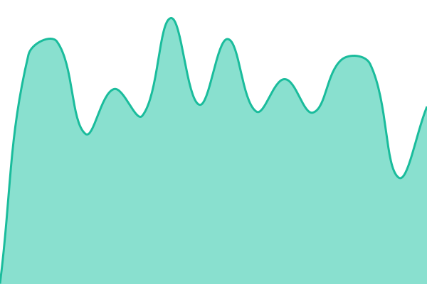
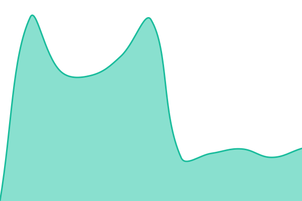
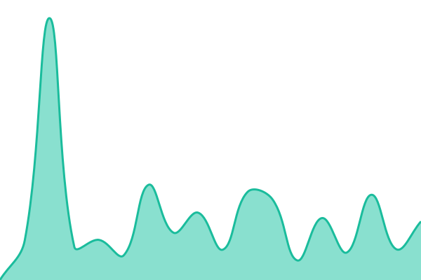
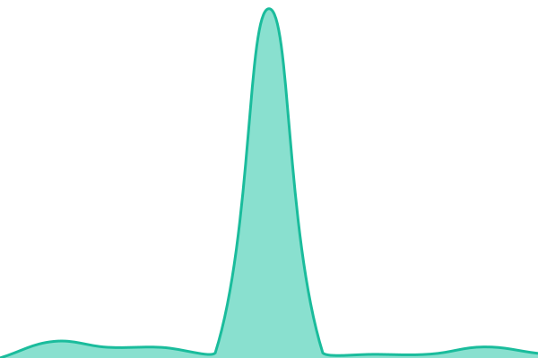
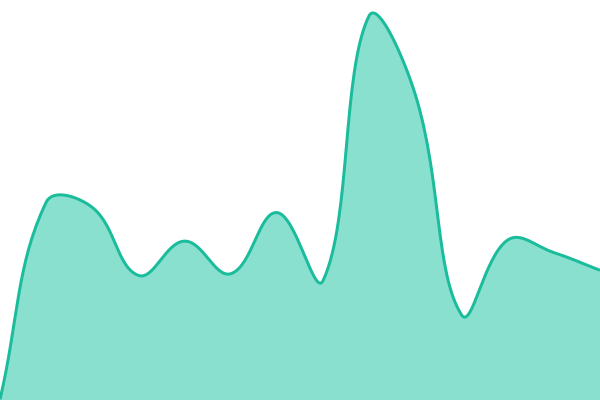

# Lexifina Status

Uptime monitoring and the public status page for [Lexifina](https://lexifina.com), at [status.lexifina.com](https://status.lexifina.com).

[Upptime](https://github.com/upptime/upptime) checks each component every five minutes from GitHub Actions and records the results in this repository. The page in `site/` is plain HTML, CSS and JavaScript, deployed to GitHub Pages, and reads its data from this repository. Neither depends on Lexifina's own servers, so the page stays up when the service is down.

Incidents are opened and closed automatically as issues labelled `status`. To be notified, watch this repository and choose **Custom → Issues**.

## Live status

<!--start: status pages-->
<!-- This summary is generated by Upptime (https://github.com/upptime/upptime) -->
<!-- Do not edit this manually, your changes will be overwritten -->
<!-- prettier-ignore -->
| URL | Status | History | Response time | Uptime |
| --- | ------ | ------- | ------------- | ------ |
|  [Website](https://lexifina.com/) | Operational | [website.yml](https://github.com/alan-yahya/status/commits/HEAD/history/website.yml) | 

 5712ms
     
 | 

<a href="https://status.lexifina.com/history/website">99.97%</a>
    

|  [Web application](https://app.lexifina.com/) | Operational | [web-application.yml](https://github.com/alan-yahya/status/commits/HEAD/history/web-application.yml) | 

 734ms
     
 | 

<a href="https://status.lexifina.com/history/web-application">100.00%</a>
    

|  [Login and accounts](https://app.lexifina.com/api/public-status/components/login-accounts) | Operational | [login-accounts.yml](https://github.com/alan-yahya/status/commits/HEAD/history/login-accounts.yml) | 

 703ms
     
 | 

<a href="https://status.lexifina.com/history/login-accounts">100.00%</a>
    

|  [Documents](https://app.lexifina.com/api/public-status/components/documents) | Operational | [documents.yml](https://github.com/alan-yahya/status/commits/HEAD/history/documents.yml) | 

 711ms
     
 | 

<a href="https://status.lexifina.com/history/documents">100.00%</a>
    

|  [File uploads](https://app.lexifina.com/api/public-status/components/file-uploads) | Operational | [file-uploads.yml](https://github.com/alan-yahya/status/commits/HEAD/history/file-uploads.yml) | 

 486ms
     
 | 

<a href="https://status.lexifina.com/history/file-uploads">100.00%</a>
    

|  [Document processing](https://app.lexifina.com/api/public-status/components/document-processing) | Operational | [document-processing.yml](https://github.com/alan-yahya/status/commits/HEAD/history/document-processing.yml) | 

 592ms
     
 | 

<a href="https://status.lexifina.com/history/document-processing">100.00%</a>
    

|  [AI drafting and review](https://app.lexifina.com/api/public-status/components/ai-drafting-review) | Operational | [ai-drafting-review.yml](https://github.com/alan-yahya/status/commits/HEAD/history/ai-drafting-review.yml) | 

 726ms
     
 | 

<a href="https://status.lexifina.com/history/ai-drafting-review">100.00%</a>
    

|  [Search and library](https://app.lexifina.com/api/public-status/components/search-library) | Operational | [search-library.yml](https://github.com/alan-yahya/status/commits/HEAD/history/search-library.yml) | 

 463ms
     
 | 

<a href="https://status.lexifina.com/history/search-library">100.00%</a>
    

|  [Automations](https://app.lexifina.com/api/public-status/components/automations) | Unavailable | [automations.yml](https://github.com/alan-yahya/status/commits/HEAD/history/automations.yml) | 

 4382ms
     
 | 

<a href="https://status.lexifina.com/history/automations">99.99%</a>
    

|  [Matters and client intake](https://app.lexifina.com/api/public-status/components/matters-client-intake) | Operational | [matters-client-intake.yml](https://github.com/alan-yahya/status/commits/HEAD/history/matters-client-intake.yml) | 

 375ms
     
 | 

<a href="https://status.lexifina.com/history/matters-client-intake">100.00%</a>
    

|  [Approvals](https://app.lexifina.com/api/public-status/components/approvals) | Operational | [approvals.yml](https://github.com/alan-yahya/status/commits/HEAD/history/approvals.yml) | 

 253ms
     
 | 

<a href="https://status.lexifina.com/history/approvals">100.00%</a>
    

|  [E-signatures](https://app.lexifina.com/api/public-status/components/e-signatures) | Operational | [e-signatures.yml](https://github.com/alan-yahya/status/commits/HEAD/history/e-signatures.yml) | 

 449ms
     
 | 

<a href="https://status.lexifina.com/history/e-signatures">100.00%</a>
    

|  [Live updates](https://app.lexifina.com/api/public-status/components/live-updates) | Operational | [live-updates.yml](https://github.com/alan-yahya/status/commits/HEAD/history/live-updates.yml) | 

 460ms
     
 | 

<a href="https://status.lexifina.com/history/live-updates">100.00%</a>
    

|  [Word add-in](https://app.lexifina.com/word-addin/taskpane.html) | Operational | [word-add-in.yml](https://github.com/alan-yahya/status/commits/HEAD/history/word-add-in.yml) | 

 323ms
     
 | 

<a href="https://status.lexifina.com/history/word-add-in">100.00%</a>
    

|  [Outlook integration](https://app.lexifina.com/api/public-status/components/outlook-integration) | Operational | [outlook-integration.yml](https://github.com/alan-yahya/status/commits/HEAD/history/outlook-integration.yml) | 

 592ms
     
 | 

<a href="https://status.lexifina.com/history/outlook-integration">100.00%</a>
    

<!--end: status pages-->

## License

The monitoring workflows are based on Upptime, MIT licensed; see [LICENSE](./LICENSE).
